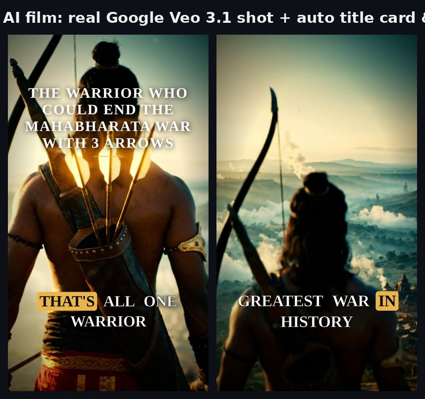
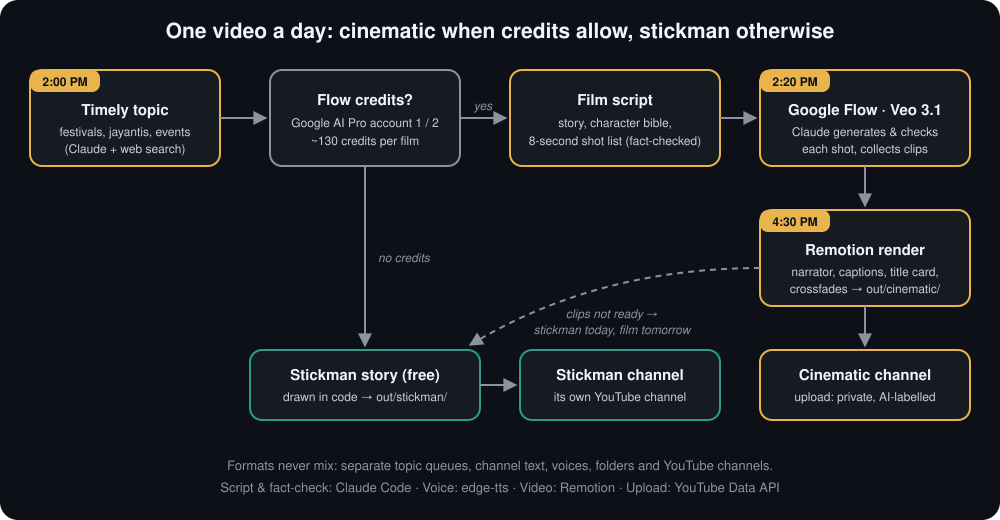
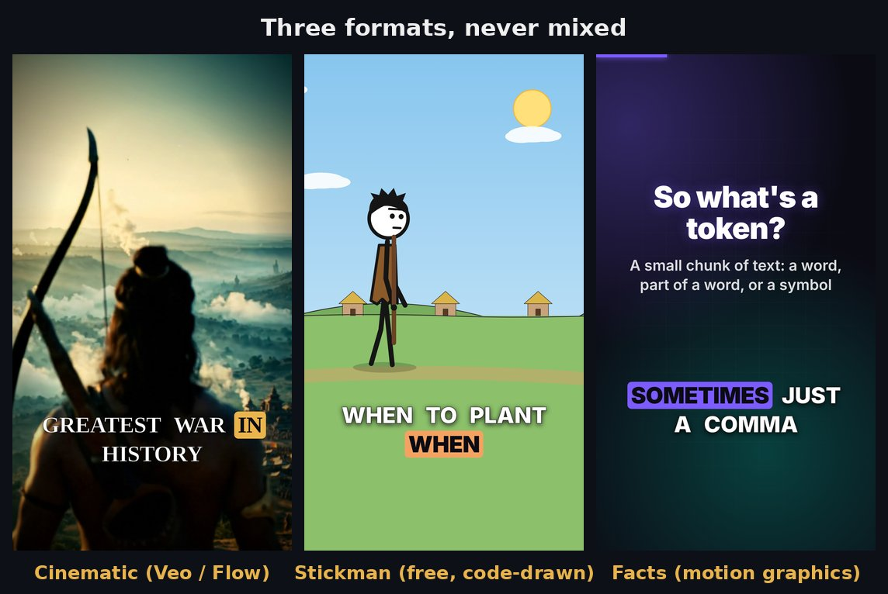
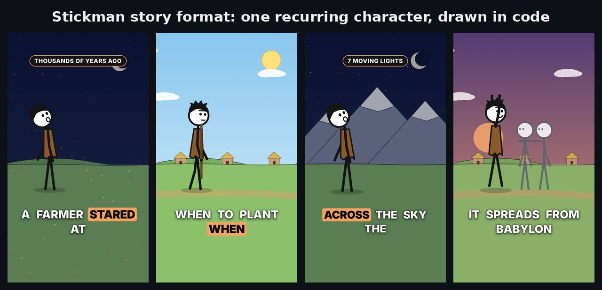

# AI YouTube Shorts Automation: Faceless Cinematic AI Videos with Google Veo, Claude Code & Remotion

> Automated **faceless YouTube channel** pipeline: an **AI video generator** that writes, voices, renders and
> uploads one **YouTube Short a day**. Cinematic AI films made with **Google Veo 3.1 / Gemini Omni** (via Google Flow
> and a Google AI Pro plan), a free **stickman animation** fallback drawn in code, **Claude Code** for scripts and
> fact-checking, **Remotion** for video assembly, **edge-tts** text-to-speech, word-by-word captions and the
> **YouTube Data API** for uploads. It also picks timely topics around festivals and events for search traffic.

**Keywords:** YouTube automation, YouTube Shorts automation, faceless YouTube channel, AI video generator,
AI shorts generator, text to video, Veo 3, Google Flow, Claude Code, Remotion, edge-tts, Instagram Reels automation,
Indian mythology videos, stickman animation.

  

## How it works

  

## Video formats

  

  

**Current format: cinematic AI films** (`config.json → video.format = "cinematic"`). Claude writes a story
with a fixed look for each character and a shot list. Each 8-second shot is generated with Google's video models
in **Google Flow** using your Google AI Pro plan. The pipeline then adds the narrator, captions, title card,
crossfades and music, and uploads the result (private, marked as AI-generated).

The stickman format (free, code-drawn) and the facts format are still built in; switch with `video.format`.

## Cinematic quick start
1. Run `setup.bat` once (see below).
2. In the Claude desktop app, sign in to https://flow.google.com once in the **built-in browser** (Ctrl+Shift+B)
   with the Google account that has AI Pro.
3. Open this folder in Claude Code (desktop app → Code tab) and type:
   - `/make-film`: next topic from ideas.csv (Barbarika's script is already written: `/film-clips barbarika-the-warrior-who-could-end-the-mahabharata-war`)
   - `/make-film Why does Lord Jagannath have no hands?`
   Claude writes and fact-checks the script, generates each shot in Flow (you can watch in the browser pane),
   downloads and collects the clips, voices and renders the film into `out\`.
4. Budget: AI Pro gives 1,000 Flow credits a month, plus a daily free allowance. A 10-shot film with
   the cheapest Veo model is roughly 100 credits plus any redos, so expect about 6-8 films a month.

**Fully unattended option (costs money):** set `cinematic.engine` to `"api"` and put a Gemini API key in
`secrets\gemini_api_key.txt` (https://aistudio.google.com → Get API key, billing on). Then `python run.py` and the
daily scheduled task generate clips with Gemini Omni Flash at about $0.10 per second (about $8 for a 10-shot film).
Your AI Pro plan includes a monthly Google Cloud credit you can claim in AI Studio to cover part of it.
Optional: put character reference images in `characters\<id>.png` for better consistency.

With `engine = "flow"`, `python run.py` / the scheduled task writes the script and shot list, then stops and tells
you to run `/film-clips <slug>`. Flow has no automation API on the consumer plan, so that step runs in Claude Code.

## Daily automation: exactly one video a day

| Time | What runs | What it does |
|---|---|---|
| 2:00 PM | Windows task (`run_daily.bat start`) | Picks a **timely topic** (web search for festivals, jayantis, events and releases in the next 14 days). If any Google account has Flow credits, it writes the film script and shot list. If not, it makes today's **stickman** video instead. |
| 2:20 PM | Claude scheduled task | Generates the film's shots in Google Flow (built-in browser), switching to your second AI Pro account when the first runs low, and copies them into the project. |
| 4:30 PM | Windows task (`run_daily.bat finish`) | Renders and uploads the film. If its clips aren't ready, it makes a stickman video so the day still gets one; the film is finished another day. |

Run `schedule_daily_2pm.bat` once to create both Windows tasks. Keep the PC on and the Claude app open between 2 and 5 PM.

**Formats never mix.** Each format has its own:
- topic queue: `ideas_cinematic.csv`, `ideas_stickman.csv`
- channel text, voice and colours: `config.json → channels / voices / video.theme_presets`
- output folder: `out\cinematic\`, `out\stickman\`
- YouTube channel: link it once per format with `python scripts\upload.py --auth --format cinematic` and
  `python scripts\upload.py --auth --format stickman`. A format with no linked channel is never uploaded
  anywhere; its videos stay in its own folder.

**Credits:** tracked per Google account in `state\credits.json` (`python scripts\credits.py show`).
Films continue while any account can afford one (about 130 credits for 10 shots); otherwise it's stickman until a refresh.

---

## 1. Setup on Windows (one time)

1. Double-click **`setup.bat`**. It installs Node.js, Python and FFmpeg if they're missing (via winget),
   then the packages, then renders the sample video with a real voice into `out\`.
   If it says tools were just installed, close the window and run it again.
2. Make sure Claude Code is logged in: open a terminal and run `claude` once.

## 2. Use it from Claude Code (recommended)

Open this folder in the Claude desktop app (Code tab, choose this folder) or run `claude` in it. Then:

| Command | What it does |
|---|---|
| `/make-video` | Next topic from ideas.csv → script → **Claude fact-checks and edits it** → voice → video |
| `/make-video Why do cats purr?` | Same, for your own topic |
| `/batch 5` | Five reviewed videos in a row |
| `/new-topics 30` | Brainstorms 30 new question topics into ideas.csv |
| `/review-script <slug>` | Fact-check / tighten an existing script |
| `/add-asset a horse prop` | Claude draws a new prop/setting/pose and adds it to the library |

You can also just ask: "make Tiko's tunic blue", "add Hindi narration", "make the hook scene zoom faster".

## 3. Or run it without Claude Code's chat

- `make_video.bat --no-upload`: one video from the next topic
- `make_video.bat --topic "Why is the sea salty?" --no-upload`
- `schedule_daily.bat`: run the full pipeline (including upload) every day at a time you choose. Logs: `state\log.txt`

The unattended run skips the human review step, so videos upload as **private**. Watch them in YouTube Studio
before publishing.

## 4. YouTube upload setup (one time, ~10 min, free)

1. https://console.cloud.google.com → create a project → **APIs & Services → Library** → enable **YouTube Data API v3**.
2. **OAuth consent screen**: External, add your Gmail as a test user. Then click **Publish app**, so the sign-in doesn't expire every 7 days. You'll see an "unverified app" warning when signing in, which is fine for personal use.
3. **Credentials → Create credentials → OAuth client ID → Desktop app**, download the JSON, save as `secrets\client_secret.json`.
4. Run `python scripts\upload.py --auth` and sign in with the account that owns the channel.

Uploads go up private by default (`config.json → upload.privacy`). Google may also keep uploads from new,
unaudited API projects private. Publish from YouTube Studio after checking each video.

## 5. Customize

- **Channel**: `config.json → channel` (niche, audience, style, call to action). Claude writes from this.
- **Tiko's look**: `config.json → story.character` (`outfit` colour, `hair`: messy / spiky / long / bun / none).
- **Voice**: `edge-tts --list-voices`. E.g. `en-US-AndrewNeural`, `en-GB-RyanNeural`, Hindi `hi-IN-MadhurNeural`,
  Odia `or-IN-SukantNeural`. Set `channel.language` to match.
- **16:9 too**: `"formats": ["Short", "Wide"]`.
- **Preview / tweak visuals live**: `npm run studio`.

## Staying monetizable

YouTube won't monetize generic, repetitive, mass-produced channels. It looks at the channel as a whole.
Your advantages here: a recurring character, real stories, and a fact-check step. Keep it that way:
review scripts, vary settings and story shapes, add new props and scenes over time (`/add-asset`), and
post good videos rather than many.
